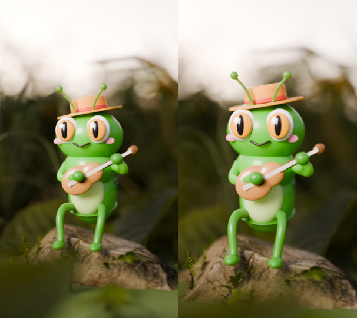
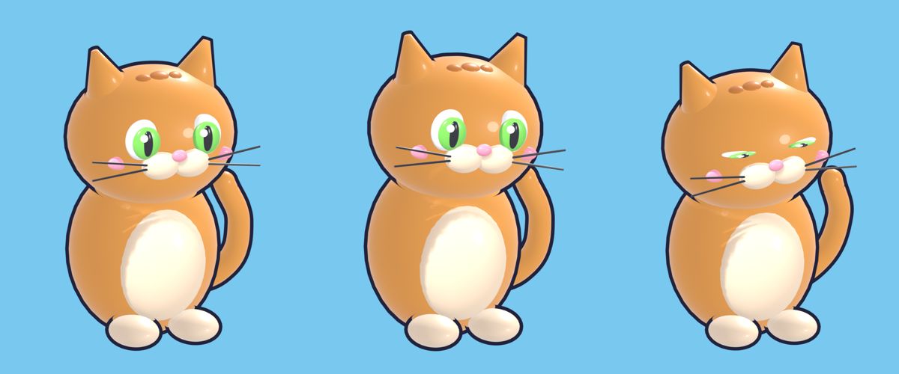

# Procedural kids' shorts — 3D animation generated 100% by code

Vertical (9:16) short videos for kids, where **every character, scene, animation, soundtrack and
edit is generated by Python** — Blender driven headlessly through `bpy`, compositing with
Pillow/NumPy, synthesized audio and final assembly with ffmpeg. Built with Claude Code as a
pipeline I can re-run to produce new episodes.

| A Cigarra e a Formiga | Ovo surpresa | Qual é a sombra? |
|---|---|---|
|  |  |  |

## Episodes

**`qual-e-a-sombra/` — "Guess the shadow"**
- `bichos3d.py` — toy-style 3D animals built from primitives in Blender (headless), rendering a
  seamless idle loop with a transparent background. Also used as a library by other episodes.
- `sombra.py` — composes the short: silhouette → reveal → name, with text, effects and audio.
  Starts a few seconds in so the first frame already shows the silhouette (hook/thumbnail) while
  the loop stays perfect because video and audio are rotated together. `--3d` uses the Blender loops.

**`ovo-surpresa/` — "Surprise egg"**
- `ovo3d.py` — the egg wobbles, cracks (procedural `bmesh` fracture), the shell flies off and an
  animal jumps out — 180 frames rendered with transparency.
- `ovo.py` — final composition: background, "TOC!" text, confetti, audio.

**`cigarra-formiga/` — "The Ant and the Grasshopper"** (Aesop, public domain)
- `roteiro.md` — script, character sheets and per-scene prompts (style bible for an AI video pipeline).
- `blender/cena1_cigarra.py` — Cycles scene at insect scale: the grasshopper plays a ukulele on a
  mossy rock among real CC0 plants (Poly Haven) with an HDRI lake out of focus.
- `montar_cena1.py` — assembles the render into MP4 with a **procedurally synthesized soundtrack**
  (Karplus-Strong plucked-string ukulele, C–Am–F–G at 120 bpm, birds and wind) and subtitles.

## Running

```bash
blender -b --factory-startup -P qual-e-a-sombra/bichos3d.py -- --animal gato --out out/3d
python qual-e-a-sombra/sombra.py --3d

blender -b --factory-startup -P ovo-surpresa/ovo3d.py -- --egg 0 --out out/3d
python ovo-surpresa/ovo.py
```

Requires Blender 4+, Python with Pillow and NumPy, and ffmpeg on PATH. Poly Haven assets (CC0)
are downloaded into `assets/polyhaven/` and are not versioned.

**Stack:** Python · Blender (`bpy`, `bmesh`, Cycles) · Pillow · NumPy · ffmpeg · audio synthesis · Claude Code
